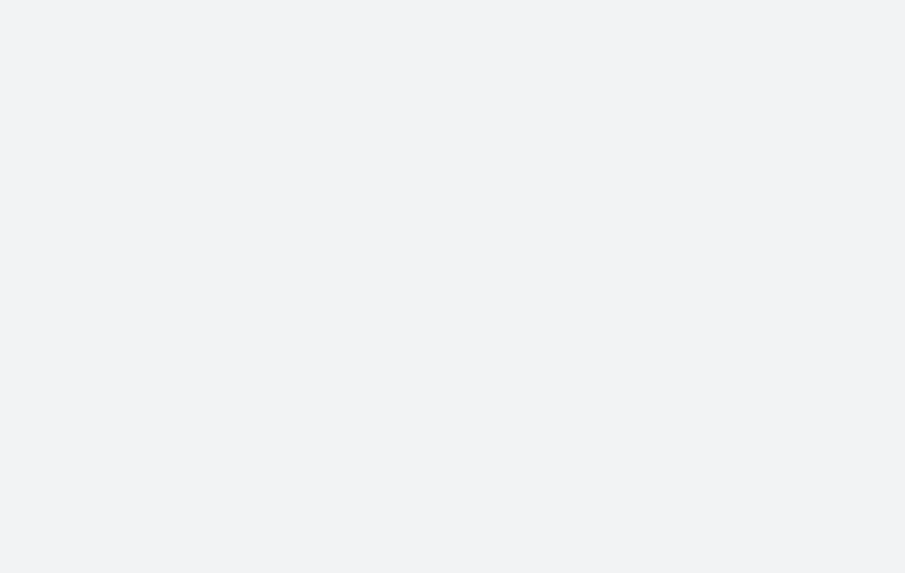

---
# Copied by `npm run new:project -- <slug>`. The build checks every field
# against src/content.config.ts and names the one that breaks a rule.

title: Project title
subtitle: Paper subtitle, or delete this line

# One plain-language sentence. No em dashes, no colons.
summary: Say what the work shows in one sentence a curious non-expert would follow.

authors:
  - { given: Steffen, family: Holter, url: "https://github.com/5teffen" }
affiliations: []

venue: Preprint, under review
date: 2026-01-01
draft: true # remove once the page is ready to go live

# Fixed order Paper, Demo, Video, Code, Data, BibTeX. Leave out what does not exist yet.
links:
  # paper: https://arxiv.org/abs/...
  # demo: https://demo.steffenholter.com/SLUG
  # video: https://...
  code: https://github.com/5teffen/SLUG
  # data: https://doi.org/...

bibtex: |
  @misc{holter2026slug,
    title  = {Project title},
    author = {Holter, Steffen},
    year   = {2026}
  }

citation:
  type: article
  title: Project title
  year: 2026
license: MIT

hero:
  # Required still image, used on the page, the social card and the README.
  # For a live figure, also add Hero.astro next to this file (see the pilot project).
  poster: ./poster.png
  # video: /projects/SLUG/hero.mp4
  alt: Describe what the poster shows
---

## The question

What problem does this work address, in plain language.

## What we did

<Figure caption="A caption in one or two sentences.">
  
</Figure>

A paragraph with a margin note<Sidenote>Sidenotes sit in the right margin on wide screens and open inline on phones.</Sidenote>.

## How well it works

## Reproduce it
